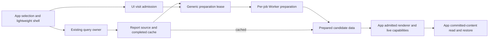

# Staged content presentation

Status: F1 merged in #2712; F2 and its generic preparation boundary approved by two independent reviews. Implementation tracked in #2711. Overall review tier L2. F3 remains profile-first investigation. No change to parser/sanitizer/file authority or persisted schemas.

## Desired behavior

Selection and a lightweight shell respond immediately. Query reads start independently. A heavy region displays its own pending/error feedback while its owning feature prepares content. The current visit can admit prepared content; only its actual complete committed content is eligible for read/restore policy. Ordinary already-mounted streaming/live state remains reactive. Native spring motion keeps its existing owner and reduced-motion behavior.

A new feature supplies its existing data source/readiness, stable selection key, content and pending/error surfaces. If it has expensive pure preparation, it owns a typed preparation capability and input identity. There is no feature-name registry or generic loader/cache to keep synchronized.

## Responsibility and public contracts

| Owner | Contract | Does not own |
| --- | --- | --- |
| `ui/content-presentation` | `useContentAdmission(selectedKey: string | null, eligible: boolean): boolean` | Data, requests, source revisions, domain readiness, body rendering, read eligibility |
| Query/store owners | Existing request/cache/retry/command results | Motion or whether a view has committed |
| Report feature | Canonical decode, preparation, immutable-card cache, prepared model/resource state | Navigation/read receipt policy or stored file capabilities |
| `systems/content-preparation` | `usePreparedContent(selectionKey, input, store, enabled)`; exact leases, cancellation, candidate/error/retry | Query/cache/algorithm ownership, DOM commit, read/restore policy |
| `systems/worker-task` | One typed cancelable native Worker per uncached task | Report algorithms, URL/file admission, feature routing |
| App route/Track composition | Authenticated scope, injected execution, current source/visit, report/panel slots and read/restore predicates | Copies of report policy or a second transcript/business store |
| Existing motion UI | Native spring playback and cancellation | Fetch/preparation eligibility |

Admission extracts the existing chat scheduler: fresh observed selection/eligibility creates an internal generation; null/unavailable cancels it; two rendering callbacks then a transition permit content. A→B→A rejects A1 callbacks. After admission, same-selection updates remain immediate. It is a rendering opportunity, not two painted frames, animation completion, commit, visibility, authorization or a hard time budget. No per-feature frame/duration/priority registry or global context is introduced. No data preparation is executed inside startTransition callbacks.

Actual content evidence belongs in the mounted content subtree. Prefer existing effects inside that subtree, carrying the exact current data/activity, rather than a generic framework marking things read. If a parent needs a mount-completion signal, the child supplies an opaque current visit/input token at actual commit; callers reject stale tokens. Do not invoke a `useCommittedCallback` child-layout callback before its parent update.

These arrows describe responsibilities, not a second global data store. The renderer still requires admission when data is cached. A short cached admission gap needs no simulated network-loading message. The existing report owner supplies its prepared model; another feature supplies its own readiness rather than extending a central feature list.

## Slice F1: foundation and conversation migration

1. Add the public admission hook, README and relocated/extended invariant tests under `ui/content-presentation`.
2. Replace app's `useThreadPresentation` call with the generic hook. Keep thread eligibility, side source/menu recognition, receipts, outbox, drafts, stop/send and main/side ownership unchanged.
3. Delete chat's duplicate scheduler; keep production router/browser regressions. Update the maintained presentation guide and chat README to the new owner, without retaining a compatibility alias.
4. Register exactly the ownership row requested in the tracking issue; no gate rule/dependency/test-name inventory changes.

This is a behavior-preserving foundation. Critical generation fencing is mutation-verified, and existing production conversation presentation/switch/read tests remain authoritative.

## Slice F2: Track composition

Both `/track/:id` and DailyTodayRoute consume the same staged report composition. Initial missing detail renders a neutral selected-route pending surface; it must not synthesize a Track object or permissions. Matching detail renders the real Track shell and current actions immediately. Query and conversation/card/live-resource owners start at their existing declared scope rather than waiting for report syntax.

Split the report owner's cheap normalized report model from expensive syntax/outline preparation. The immutable-card cache remains authoritative; non-report card and overlay updates reuse it. It exposes completed results without doing expensive work during shell render. The report preparation resource identifies source by the immutable report card, fences async completion, and reuses completed cache values. A request's preparation capability cannot capture file/navigation callbacks or DOM.

Chosen initial preparation direction to validate: an explicit native Worker execution capability for cold report preparation, using the canonical `prepareReportDocument` algorithm. Current S1 sampling already found meaningful pure preparation, while warmed returns still have DOM cost. Generic Worker lifecycle belongs to systems; report owns its worker entry/protocol payload and app injects a factory scoped to TrackViewProvider. Production uses native execution, tests explicitly select the same canonical algorithm through an inline executor or controlled port. No missing-Worker synchronous fallback. A required injection is swept through actual production and all router fixtures/callers; no helper hides missing fields. One active execution is bounded; canceled/abandoned visits cannot queue indefinitely. Worker errors and structured-clone failures expose local retry/error, not permanent busy state. Scope disposal terminates the worker.

### Source identity, Worker association and lifetime

The report owner exposes a stable source record for each immutable report card, decoded through canonical core policy. Source wire identity and normalized report identity are distinct. Cache entries are keyed by the original card, not IDs/revisions supplied by worker replies. The executor associates each response with its exact current request handle and generation.

A successfully structured-cloned PreparedReport becomes the authoritative visible prepared model for that source record. Its own `prepared.report` object is passed as ReportDocument's report prop; do not pair it with the earlier main-thread decoded object or rewrite its identity assertion. Whole-model metadata and block slots travel together. Current authority callbacks/resources remain outside that data. Existing synchronous cache/read consumers still use canonical preparation and keep their current contract. Add actual Worker round-trip identity/clone tests plus a request/source replacement test.

The report preparation port is an explicit required AppRouterDeps capability: `(report, signal) => PreparedReport | Promise<PreparedReport>`. Production selects native Worker execution; tests explicitly select the same canonical inline preparation function or a controlled executor. Sweep the current49router-caller files as ordinary typed API consumers; this number is investigation evidence, never a permanent check/list. No missing-field backfill or environment-dependent sync fallback.

Choose a per-job Worker lifecycle initially, removing the need for an idle-host manager: the systems executor creates one dedicated Worker per uncached preparation call, posts one input, and terminates it on success, failure, message/clone error or abort. It removes message/error/signal listeners exactly once. No idle Worker, pending queue, global registry or shared process survives a job. Report-resource effect cleanup aborts the active job before another source starts, so one visible report resource owns at most one current job. Other concurrently visible regions own independent jobs and cannot cancel each other. Closing/unmounting/auth-scope loss aborts the region; StrictMode setup gets a new task and cannot reuse a disposed singleton. A failed job exposes local retry/error; retry starts a fresh Worker. The per-job startup/clone cost must be included in cold measurements; add idle reuse only if a measured need justifies that lifecycle.

The generic executor accepts a Worker factory, opaque typed input and AbortSignal; its server helper invokes a supplied task algorithm and answers once. Channel instance + local settled fence identify the request, so no global request counter or domain identity travels into generic code. The report owner binds the returned model to the caller's source record only if the exact current source/visit lease still matches. The Worker entry uses canonical report preparation, does not access DOM/resources and returns data only.

### Displayed revision and current authority

The generic resource retains a same-selection prepared candidate while a replacement input prepares. The report feature adapts that candidate to its typed source/model. Only app composition records which candidate actually committed in this visit and may retain that committed report during replacement. A cached candidate withheld by admission cannot become a visible fallback. Data status and candidate identity remain separate from DOM commit and current-source eligibility. A new Track has no retained value from the old Track. Its local busy/error surface offers retry without removing unrelated header/composer/actions.

Revision-specific resource demand follows the displayed report while it is retained: series id@rev, preview definitions/polling and task declarations use `visible.prepared.report.blocks`. Before any report is visible, cheap decoded current declarations may start those reads without waiting for syntax. Pending-revision prefetch is omitted initially; it must not displace the visible revision's queries. Once preparation succeeds, visible report, outline, reference context, task declarations and revision-specific resolver demand switch together. Current workspace roots, navigation callbacks, permissions, openable-card authority, live overlays and execution results remain current render inputs; they are not cached with R1. This distinction must be tested with retained rev1 series/preview while rev2 removes or changes them.

Read eligibility is conservative: current source identity equals displayed source identity, all requested loaded content is mounted, route identity matches and existing visibility conditions hold. While R2 prepares or fails, no newly advanced aggregate activity high-water mark is acknowledged through visible R1, even if the advance came from another fact; previously owed R1 acknowledgements remain owned by the receipt provider. When the report card is unchanged and only live overlays advance, current displayed source still matches and the existing receipt/activity behavior continues. Do not infer report identity from the activity timestamp, and do not advance receipts by a max(latest activity) guessed from a Worker completion.

TrackReportContent is the app-owned committed subtree. Its read effect captures the displayed preparation/current-source eligibility and exact current Track/activity/openedAt from that same committed render. Empty success also mounts this subtree. Pending, failed and incomplete content cannot acknowledge unseen facts. The generic hook's boolean is only admission; the effect inside actually mounted content supplies the commit boundary.

### Reading and anchor readiness

Reading state records URL destinations immediately. For F2 the full ReportDocument mounts atomically once prepared/admitted; its report-readiness value is observed in a layout effect after that same commit, not at shell arrival. Restore the report scrollport only then. Panel/grid continue at their own actual mounted readiness with the existing selected-card reveal coordination; no extra generic guessed-frame retries. Pending shell must not clamp/remember report offset0. Refresh retaining an already-mounted R1 does not restart initial restoration. Explicit hash destinations beat saved offsets.

Record explicit pending reader input in the owning scrollport (wheel/touch/scrolling keys/scrollbar gesture) to suppress deferred automatic restoration, rather than treating any offset change as intent. Capture input from shell mount, but do not save placeholder geometry as a new reading position. Keep the existing feature reading owner for selection/native Find; do not globally intercept browser Find.

Anchor arrival is an app-owned request record with visit + explicit navigation intent, distinct from a persistent hash. `useGo` gives explicit block actions a 128-bit random token from the LAN-supported `getRandomValues` API; ordinary file/panel/search moves do not rearm it. Hash changes still support cold/shared/history destinations. Last-defined intent survives temporary state removal and Back. App router disables its duplicate automatic hash reveal so only complete report content owns this operation. A new request while current report is pending stays pending until that current source actually commits. Consume it once after reveal, or report a missing target after complete content, and do not replay an already-consumed request on an ordinary R1→R2 update. Same-hash repeated navigation produces a new request through its navigation intent; old visit callbacks cannot consume it. Today embeds the same composition/readiness contract, rather than requiring a `/track/` URL check.

## Slice F3: profile-driven mounting work

Measure ordinary production before introducing additional scheduling. Profile React render, DOM commit and forced layout separately. Inspect ListText overflow geometry reads and preview setup using current source evidence.

If one complete report mount still monopolizes the main thread, introduce append-only batches in the report owner with stable block keys and one whole-report reference/outline model. Existing mounted blocks must not be rerendered quadratically as batches append. Process/task/live blocks retain their owners. Show incomplete status; full-read/initial restore completes only after all loaded blocks are mounted. Keep all final DOM and verify native browser Find and cross-block selection. Common scheduling can be extracted only when truly business-free; report block recognition/ordering remains report-owned.

## Rollout and developer exercises

- Another report block changes its existing domain/renderer contracts. It adds no admission switch, worker registry entry or test inventory.
- Another expensive preview composes its current files/read capability with its own preparation input and admission instance. Closing cancels presentation/task resources, not unrelated dispatched commands. It need not import Track or Chat.
- Loaded-history search keeps corpus/results and navigation in Chat; generic admission cannot infer full history or selection intent.
- A cheap page can keep its direct rendering path. This is an opt-in heavy-region boundary and requires no mandatory Worker or loading indicator for ordinary content.

## Verification and completion

Production red cases before each behavioral fix: cached and delayed detail shell; immediate request start; pending report controls/navigation; current preparation and A→B→A; changed input vs unchanged overlays; before-content receipts; empty/error/retry; saved report/grid/panel and file/card destinations; delayed same-hash anchor; pending reader action; Today; separate conversation main/side and live streaming/side command.

Generic tests cover initial/late eligibility, cancellation at both callbacks and queued transition, StrictMode, independent instances and same-target updates. Worker tests use actual entry/algorithm and structured clone, crash/message error/abort/retry/scope cleanup. Critical stale/no-premature-read assertions get production-only single-factor mutations in exclusive recoverable worktrees, with complete predicted red sets over whole observing targets and exact restoration.

Use existing auto-discovered tests, full FE lint/build/unit/browser, text ratchets and Tier1 smoke. No real Codex E2E on this host. Two independent L2 reviews inspect each frozen behavior diff and all five architecture priorities; both refresh after behavioral fixes. CI green before exact-head squash; compare actual squash patch/tree/trailers afterwards.

Maintain a production-entry Track profile tool with build metadata and API-only fixtures. Separate normal-production latency cohorts from CPU/React tracing. Match small/long varied reports, cold/warm returns, delayed data/preparation and rapid switch at desktop/mobile, plus reduced motion/native Find. Record shell, data, preparation, first/full content commit and input response independently; rAF is not compositor FPS and DOM is not paint/INP. Retain every attempted sample/failure and report body-latency tradeoffs. Final evidence must describe the final source, not reuse older cohort numbers as current.

## Markdown execution environment

The canonical Markdown parser depends on a decoder with conditional exports. Its browser entry touches DOM, while its published default and worker entries use the same pure entity table. One exact-package alias, resolved through Node's public export contract, selects that published implementation in production and every isolated test project. The decoder is explicitly declared at its already locked1.3.0 version, avoiding a dependency on transitive hoisting. This does not fork parser/sanitizer policy or infer a private package path. Existing security/contract oracles and independent entity expectations accompany real native Worker and production-asset verification.

## Generic preparation extension

A new expensive feature provides a stable `PreparationStore<Input, Value>` with `peek` and cancelable `prepare`; it owns the cache and algorithm. `usePreparedContent` owns exact selection/input/store leases and reports waiting/preparing/ready/failed plus a data-only candidate and retry. Sync values/throws and Promise outcomes use the same channels. Disabling aborts execution; a completed cache hit can remain data-ready while admission is closed. The feature need not name Track or Report or register a task globally. The app separately chooses actual committed fallback, authority and restoration.
