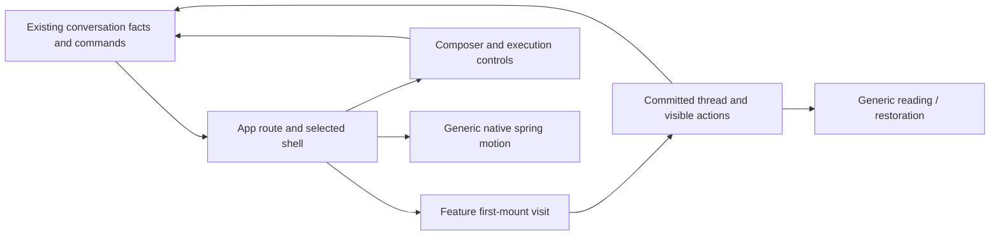

# Responsive presentation boundaries

Keep the existing React, Query and Motion stack. Route selection and a lightweight
shell commit before a newly eligible conversation thread mounts. This creates a
rendering opportunity; React scheduling does not make DOM commits interruptible or
guarantee an uninterrupted frame rate. The current implementation retains all
loaded history so native Find and cross-message selection keep their DOM.

## Where a feature developer starts

| Responsibility | Existing entry and owner | Extension rule |
| --- | --- | --- |
| Conversation facts and commands | `app/conversations/store.ts`, `contracts.ts`, Query and ConversationProvider | Consume their declared results. Do not reconstruct transcript, outbox acknowledgements or send readiness in presentation code. |
| Route, main/side association and selected shell | `app/router/public.tsx` | Compose capabilities and layout. Slow history must not be awaited before committing the selected shell. |
| First eligible thread mount | `features/chat/thread/presentation.ts` | Supply selected identity and existing content/status eligibility. Close, switch and loss of eligibility cancel that visit. Same-conversation updates after mount stay immediate. |
| Visible messages and reading memory | `features/chat/thread/public.tsx`, `message-entry.tsx`, `reading-view.tsx` | Keep grouping keys, expansion and focus memory in the committed UI path. Extend the feature's presentation contract. |
| Generic reading and restoration | `ui/drawer/follow-scroll.ts`, `restore-focus.ts` | Declare navigation, return and restoration explicitly. The primitive observes input/focus/selection; it never knows message identities. |
| Motion | `ui/motion/spring.ts`, `target.ts` | Supply targets to the shared spring. Keep semantic state and cancellation in the component owning the surface. |
| File preview | `systems/cards/builtins/file-viewer.tsx` → `systems/fs-viewers/public.tsx` | Use existing files/theme/slots capabilities. A future compute or visibility contract must be declared here before a new consumer relies on it. |

Paths above are relative to `fe/web/src`. Runtime imports still flow
`app → features → systems → ui → core`; feature domains do not import each other.
The app injects read data and commands into a feature; features must not import
app store/contracts. These responsibilities are not a requirement to add five files for an ordinary
feature, nor a new global task/store framework.



The arrows describe responsibilities, not every import or a second business store.
No asynchronous transcript projection, new cache or Worker is currently present.

## Lifetimes and action consistency

A selected conversation, a history request and a presentation visit are different
lifetimes. Closing invalidates pending presentation callbacks. Dispatched sends, uploads
and existing-conversation composer state retain their current owners. New-
conversation drafts follow the existing draft policy: undispatched drafts may be
discarded on close or route cleanup, while dispatched attempts retain their
delivery/retry identity. A→B→A is a fresh visit; a callback from the
first A cannot admit the second A. Main and side panes use separate hook instances.
A history response becoming eligible after a delay starts its own admission rather
than consuming the opportunity while data was unknown.

The app admits read receipts only after presentation plus the existing history,
error and visibility conditions. Readiness is not a send authorization. Stop, send
and queue actions keep their current business owner. Copy/edit/regenerate retain
the currently committed message's existing action bindings; no delayed snapshot is
mixed with a newer transcript. `/side` remains recognized while pending, but its
source-dependent command refuses and retains the draft until history and source
presentation are ready. The selectable menu uses the same source readiness.

For ordinary content growth, the follower first checks current selection, so queued
selection events cannot lose to a resize callback. A newly observed non-collapsed local extent
pauses following, including at the tail. Explicit return and native downward return
acknowledge the held extent. Observed clear/extent changes can pause again; an
unobservable same-task clear/reselect of identical points is not distinguished.

Use `restoreDrawerFocus(element)` for automatic focus restoration after DOM
replacement. Use `withScrollRestoration(panes, restore)` for synchronous layout and
reading-place restoration. The outer entry first samples pending reader selection;
exit acknowledges restored selection without undoing an explicit return. Naked
`focus({preventScroll:true})` does not declare restoration to the follower. Native
browser-chrome Find may expose no DOM Selection and is not intercepted here.

## Three extension walkthroughs

1. **Another message rendering form.** Start at ChatThread/MessageEntry. Add visual
   inputs and feature tests; put any new domain rule in its core owner. Existing
   image files stay an injected host capability. There is no need to touch motion,
   transport, Query internals or a Worker registry.
2. **Search within a conversation.** Start from the one assembled transcript and
   make the searched scope explicit (for example, loaded history only). Search
   query/results belong to Chat. `ThreadReadingView` currently owns grouping and
   expansion, not a public message-locator command; extend the reading owner for
   locating matches across folded groups instead of having app/search algorithms
   query DOM nodes. Global/full-history search needs a separately declared read
   capability. Only add an asynchronous compute port after measuring that pure
   search computation is the bottleneck.
3. **An expensive file preview.** Start at the existing file-card adapter and
   FileViewer's files/theme/slots inputs. File access remains with its current
   host capability. FileViewer currently has no injected compute or visibility
   port; design that explicit contract before using it. If measurement warrants
   background computation, core owns the pure algorithm/port and systems owns
   execution/resource release. Card hiding is not necessarily unmounting, and a
   file preview must not import Chat's visit hook or create a second card host.

A future pure background projection needs explicit input identity, hard invalidation
and a bounded scheduling/error/lifetime contract. It must not move outbox facts,
read-order evidence or committed grouping memory into a second authority. Do not
add these abstractions until a real measured consumer needs them.

## Verification entry points

From `fe/`, the focused production-owner checks are:

```sh
npx vitest run --project web-dom web/src/features/chat/thread/presentation.test.tsx web/src/app/router/conversation-presentation.test.tsx
npx vitest run --project browser web/src/app/router/conversation-switch.browser.test.tsx web/src/app/router/chat-performance.browser.test.tsx
npx vitest run --project browser --project web-dom web/src/ui/drawer/selection-follow.browser.test.tsx web/src/ui/drawer/selection.test.ts web/src/ui/drawer/follow-scroll.browser.test.tsx web/src/ui/drawer/follow-scroll.test.ts web/src/features/chat/thread/scroll-follow.browser.test.tsx
```

These exercise the actual router/thread/follower, not a copied scheduling algorithm.
Run browser targets sequentially on the shared host to avoid contention on the
runner's default browser-server port (63315) and CPU resources. Full frontend, text and integrated gates still follow repository guidance.
Switch reports distinguish shell commit, first animation-frame opportunity and body
commit. Render counts alone do not establish paint latency.

## Attribute a hotspot before changing it

The router benchmarks above report broad React scopes and work boundaries. Use
browser source-level profiling to distinguish application computation, dependency
work, native layout and paint before choosing a fix. Main rAF gaps and the number
of renders alone do not identify the responsible call path.

From `fe/`, create a local production build with source maps:

```sh
node tools/preview/profile-build.mjs
```

It prints a fresh temporary output directory and writes `profile-build.json` there
with the commit, working-tree dirty flag and profiling settings. Source maps embed
the actual built source; a dirty flag means the commit alone does not identify it.
Normal `npm run build` and deployment outputs are unchanged. Replace the example
directory below with the printed one; port 0 selects a free loopback port:

```sh
npx vite preview --outDir /tmp/neige-profile-XXXXXX --host 127.0.0.1 --port 0 --strictPort
```

Use your own development backend as described in
[development preview](development-preview.md). Do not publish diagnostic source maps
or raw recordings with application deployments.

In [Chrome's Performance panel](https://developer.chrome.com/docs/devtools/performance/reference),
record one named interaction, select its time range, and inspect Main, Bottom-up,
Call tree, Layout/Paint and animation tracks. Source maps map generated frames back
to their owning file. Keep application, dependency and browser work distinct;
`@astryxdesign/core` is a dependency, not this repository's `fe/core`. Inclusive
function costs overlap and must not be summed as independent CPU buckets.

For React scheduler/component attribution, use a separate profiling build:

```sh
node tools/preview/profile-build.mjs --react
```

This opts into `react-dom/profiling` through a build-time alias. Normal production
React profiling is disabled. [React Performance tracks](https://react.dev/reference/dev-tools/react-performance-tracks)
show scheduling/render/commit/effect phases; in a profiling build, component tracks
need a Profiler subtree or React Developer Tools. Existing browser benchmarks use
Profiler scopes in the development test build. Profile builds and DevTools add
overhead, so repeat final latency comparisons with normal production React.

[Long Animation Frames](https://developer.chrome.com/docs/web-platform/long-animation-frames)
can further attribute long-frame scripts and forced style/layout. Check support
before recording it. Missing script attribution is not proof of zero work; native
layout and cross-context activity still require the browser trace. Keep raw traces,
CPU profiles and detailed page data local unless their publication is authorized.

## Current performance decisions

- Keep all loaded message DOM. A temporary agent-only `content-visibility:auto`
  experiment reduced layout work, but native browser Find could reveal a match and
  immediately lose its position. The user chose native Find and cross-message
  selection; the experiment is not product code. Layout/style containment alone
  showed no useful reduction in the same diagnostic workload.
- Do not add a Worker/Comlink layer for this workload. The measured expensive calls
  include synchronous DOM commit, layout and style work; a Worker cannot perform
  those operations. The first-mount visit is a presentation boundary, not a thread.
- Native opacity/translate spring playback is already separate from per-frame
  React state updates. Starting/reversing it, committing DOM and layout still need
  the main thread. A main-thread rAF gap is not itself a measured compositor freeze. Chromium
  explicitly distinguishes partial presentation (which can include compositor
  updates) from dropped frames in its [frame reporter contract](https://chromium.googlesource.com/chromium/src/base/+/c505b1aab61c4a0e444a2aefe7b98dcf6026ebda/tracing/protos/chrome_track_event.proto).
- #2235 remains the owner of retained DOM and further long-history performance.
  Reconsider windowing only with an explicit Find/selection/anchor/accessibility
  contract and new end-to-end evidence. Do not add scroll-correction loops or
  infer user intent merely from an offset changing after content growth.

Tracking and measured rollout: [#2665](https://github.com/keanji-x/neige-calm/issues/2665).
Implementation: [#2668](https://github.com/keanji-x/neige-calm/pull/2668),
[#2675](https://github.com/keanji-x/neige-calm/pull/2675),
[#2681](https://github.com/keanji-x/neige-calm/pull/2681).

## Production browser measurements, 2026-10-16

Fixed frontend sources: before `13e89596751231c23c0a519be1d41e5bfb7aa636`;
after `38a1920dca3cabeee6435193fc77f6643b6844ca` (all frontend files identical
at merged `2056a0eb3e2efcbbb9fd7393e53a91c224666d30`). Production builds,
Chromium 151.0.7922.34, a shared Linux host, 1400×900 and 390×900 viewports;
no CPU/network throttling. The narrow viewport is not a physical phone test.

Each condition used three fresh browser/context runs, alternating before/after
order. API responses were synthetic; the real app bootstrap, router, history
pagination (300 rows per page), Markdown, drawer and spring paths ran. Load all
history, close, reopen the cached conversation, close/open a short conversation,
return to the long one, then exercise a held slow read across close and return.
No real provider execution or performance CSS injection was used.

Values below are medians of the three runs. Shell/body times are the first
cached reopen's click-capture to DOM-mutation observation, not measured pixel
presentation. The rAF column is the median of each entire flow's maximum main-
thread callback gap. Tracing/video/sampling add overhead; these are diagnostic
samples, not CI thresholds or a guarantee for another device.

| Rows / viewport | Shell observation, before → after | Body observation, before → after | Maximum main rAF gap, before → after | Final live elements |
| --- | --- | --- | --- | --- |
| 20 / 1400px | 54.8 → 47.1ms | 54.8 → 132.8ms | 66.7 → 50.1ms | 610 → 610 |
| 900 / 1400px | 389.8 → 33.6ms | 389.8 → 468.6ms | 433.4 → 150.1ms | 5011 → 5011 |
| 900 / 390px | 89.8 → 30.5ms | 89.8 → 360.5ms | 400.0 → 100.0ms | 4972 → 4972 |

All nine candidate first cached reopens exposed a shell without a thread at
both mutation observation and the first sampled animation-frame opportunity;
all nine originals already included the body. This establishes the admission
boundary, not a paint-latency guarantee. **Body availability became later in every
case**, particularly the narrow cached reopen. Hiding and retaining a native
sheet is different from deleting its DOM; the new visit can remount its body.
The flow still has substantial synchronous work. Desktop 900-row maximum layout
cost (median across runs) was 52.8 → 61.8ms: no layout reduction is claimed.
Live DOM counts are unchanged. Heap samples varied widely, including an increase
in the long desktop case; no retained-memory saving is claimed.

Compositor traces were also collected. Partial presentation can include native
animation updates while main-thread content misses a deadline; it must not be
counted as an animation freeze or merged with duplicate pipeline reporters into
a claimed FPS. The recorded video and trace are browser diagnostics, not a
physical display/GPU measurement or a claim of perfect 60/120fps playback.

The initial narrow probe incorrectly waited for node detachment; the existing
native sheet retains hidden markup. That setup failure was preserved, the close
wait changed to visibility, and active-shell observation used its selected id.
The three narrow before/after pairs were then collected. Desktop measurement
logic and samples were unchanged; no result was discarded for being slow.

A separate headed Chromium probe used native Ctrl+F via XTest in an isolated
Xvfb display. In the final 900-row build, the historical match remained within
both desktop and narrow scrollports; DOM Selection was empty during native Find.
An actual cross-message DOM selection then retained all 380/386 selected
characters respectively. This preserves ordinary Find/selection availability;
it does not promise Find navigation will be held through unrelated future stream
growth when the browser exposes no selection/input intent.

The one-off production probe and raw reports accompany the task as the local
`neige-responsive-presentation-evidence.tar.gz` artifact. #2665 records the concise
rollout outcome. The committed router performance/switch tests above remain the
maintained, repository-visible regression entry points. Review convergence and correctness gates are
recorded on the implementation PRs; unrelated intermittent local checks remain
visible in [#2682](https://github.com/keanji-x/neige-calm/issues/2682).
